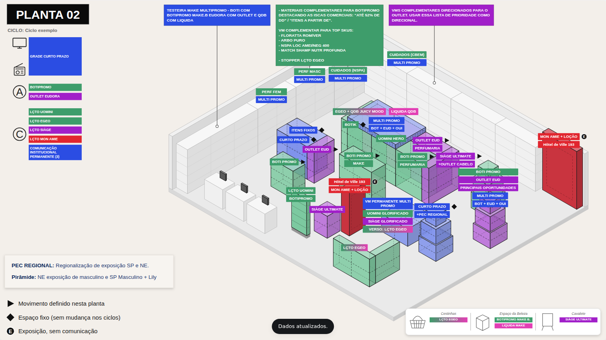

# Plano de Varejo · Visualizador de Plantas

App em **Google Apps Script** que desenha as plantas da loja em 3D isométrico, no formato de slide (16:9), com cada móvel pintado pela cor da marca. Tudo vem de uma planilha: é só trocar o **ciclo** no seletor que as cores e os textos mudam.



| Cor | Marca | Código (na planilha e no app) |
|---|---|---|
| verde | Boticário | `BOT` |
| roxo | Eudora | `EUD` |
| rosa | Quem disse, berenice? | `QDB` |
| vermelho | O.U.i | `OUI` |
| azul | Multimarca | `MULTI` (aparece como `MM`; `MM` também é aceito na planilha) |
| branco | Sem marca / sem movimento | `NEUTRO` (ou vazio) |

No app (legenda, listas, Analytics, PNG), as marcas aparecem pela sigla de 3 letras (`BOT`, `EUD`, `QDB`, `OUI`, e `MM` para a multimarca), sempre nesta ordem: **BOT | EUD | QDB | OUI | MM** (a ordem de `MARCAS` no `Config.gs`); na planilha, o nome completo (*Boticário*, *Quem disse, berenice?*…) continua aceito.

## O que ele faz

- **Abre direto no último ciclo aprovado** (o último da planilha). O link pode pedir outro ciclo, e *Atualizar* mantém o ciclo da tela. Não há opção sem ciclo: a planta sem cores só aparece quando a planilha ainda não tem nenhum ciclo. Quem está logado na validação vai direto para o ciclo em construção do seu papel (o construtor, o que está montando; o validador, o que aguarda aprovação), com uma faixa em destaque no topo avisando que o ciclo ainda não foi publicado.
- **Seletor de ciclo e abas por planta** (ER P, ER M, ER G e ER GG = plantas 01 a 04). As setas ← → do teclado trocam de planta.
- **Móveis coloridos pela marca**, com as etiquetas (caixas de texto) de cada móvel, os símbolos 🔒 (espaço fixo: a etiqueta tem borda dupla na mesma cor, e o móvel e a etiqueta ganham uma hachura diagonal numa versão mais escura da cor deles; a legenda dos símbolos mostra uma amostra da hachura), Ⓔ, NEW e ⏩ (antecipação, veja abaixo) (no PNG do slide, também a lateral TV/rádio, (A), (C) e os destaques com a miniatura do móvel), as notas e a legenda dos símbolos (no canto de baixo) e a faixa Cestinhas / Espaço da Beleza / Cavalete.
- **Modo desenvolvedor (na engrenagem, com senha)**: o item *Modo desenvolvedor* do menu de configurações pede a senha e abre o **painel do desenvolvedor**, com a construção da loja, o painel de controle das plantas, as regras da cascata entre as ERs, o calendário dos ciclos e os feriados, as senhas e as planilhas (veja [Desenvolvedor](#desenvolvedor-painel-do-app)). A construção da loja:
  - **Baixar planilha base**: gera um `.xlsx` com uma linha por móvel de cada planta, listas suspensas e cores por marca. Pode vir em branco ou já preenchido com um ciclo existente, para servir de ponto de partida do próximo.
  - **Importar planilha**: lê o `.xlsx` preenchido, grava no Google Sheets e já mostra o ciclo importado.
  - **Construir loja**: o editor do layout (posição e tamanho dos móveis de cada planta). **Salva sozinho** na aba Layout a cada mudança; *Salvar como…* cria uma planta nova ou substitui outra.
- **Zoom na planta**: role o mouse sobre a planta (ou use a pinça no celular, os botões − / + acima dela ou as teclas <kbd>+</kbd> <kbd>−</kbd> <kbd>0</kbd>). Com zoom, arraste para mover a planta. As etiquetas crescem junto com a planta, para ler melhor; as caixas de destaque continuam do mesmo tamanho na tela. A caixa das notas e a legenda dos símbolos (no canto de baixo) ficam paradas na tela, do tamanho de sempre, com qualquer zoom. Clique no percentual para voltar a 100%. O PNG sai sempre sem zoom.
- **Estratégia do móvel** (com o aviso fixo *Página em construção*, em amarelo, no topo): clique num móvel (ou numa etiqueta dele) para abrir uma tela inteira com o desenho do móvel numa faixa no topo e, embaixo, na largura toda, o **planograma**, que mostra como as prateleiras estão divididas: uma coluna por espaço (na gôndola, na ordem Ponta A, Meio A, Ponta B, Meio B, com cada meio do dobro da largura de uma ponta; frentes da mesa, blocos do balcão), com as prateleiras de cima para baixo; as etiquetas de cada espaço dividem as prateleiras na ordem (Etiqueta 1 em cima), cada uma com a cor da sua marca. No totem, cada linha é um painel; no móvel make, as testeiras aparecem por cima. A tela mostra só o planograma (sem a lista dos espaços embaixo); o móvel de atendimento, que não tem planograma, mostra a linha dele. Nos espaços em que as prateleiras foram desenhadas na construção, o planograma mostra, em cada prateleira, os quadrados com o movimento e os produtos de cada um (veja [Prateleiras](#prateleiras-o-desenho-de-cada-prateleira-com-os-produtos)).
- **Destaque ao passar o mouse**: com o mouse sobre um móvel (ou uma etiqueta dele), as etiquetas desse móvel ganham contorno e as linhas-guia escurecem; as dos outros móveis ficam mais claras.
- **Planta em tela cheia**: a planta ocupa toda a área abaixo dos botões, sem moldura, com as notas e a legenda dos símbolos no canto de baixo. O nome da ER, o ciclo, as listas de TV / rádio, (A) e (C), os destaques e os itens fora da planta (Cestinhas, Espaço da Beleza, Cavalete) não ficam no desenho: ficam em **Comunicações ER**.
- **Comunicações ER**: o botão abre um menu à esquerda da planta (com o *Analytics* aberto, o botão volta para a planta com o menu aberto) com o nome da ER e o ciclo, TV e rádio, (A), (C), os **destaques** (seção `CALLOUT` da aba Painéis; cada um com a miniatura do móvel a que se refere, na cor da marca, no lugar da caixa que apontava para o móvel na planta) e os itens fora da planta com as etiquetas deles. No PNG do slide, os destaques vão na coluna lateral, depois do (C), também com a miniatura do móvel. Com uma marca no filtro, as etiquetas das outras marcas ficam em cinza, como no slide. O app lembra se ele estava aberto; na primeira vez, abre em telas largas. No *Construir loja* e no PNG do slide, esses painéis continuam no slide, como antes.
- **Analytics**: o botão abre, na **metade direita da tela** (a planta continua na metade esquerda, com zoom e filtros), um dashboard do ciclo que compara as ERs. Cada ER é um tamanho médio da rede: o Analytics **nunca soma ERs**, toda conta é feita dentro de cada ER e as ERs são comparadas lado a lado. O botão **Sobre a análise** (ícone de informação, no topo do Analytics) abre a explicação das contas e a legenda **O que conta como espaço**: a miniatura de cada tipo de móvel das plantas, com cada espaço que ele soma numa cor, separada em espaço de exposição, espaço de VM e fora da conta. No dashboard, o **mapa de calor movimento × ER** (uma linha por movimento, uma coluna por ER, mais escuro = maior fatia da ER; alterna entre *% da ER* e *Espaços*; as linhas seguem a ER em destaque, e clicar no título de outra ER ordena por ela), com a classificação, o GMV e as marcas de cada movimento (uma bolinha na cor de cada marca, ao lado do nome), a coluna **Móveis** (o ícone de cada tipo de móvel em que o movimento está; passe o mouse para ver o nome), a coluna **Na rede** (só com a aba *Inventario*, veja abaixo: o % das lojas, o número de lojas ao lado e os espaços na rede) e uma linha *Sem movimento*; **Marcas em cada ER** e **Classificação em cada ER** (barras 100%, uma por ER; um gráfico embaixo do outro); e **GMV esperado × espaço** (gráfico de dispersão, uma ER por vez: cada ponto é um movimento, com a fatia dele no espaço da ER na horizontal e no GMV esperado na vertical; acima da diagonal de 1× rende mais que o espaço que ocupa, abaixo rende menos; passe o mouse para ver os números). Em toda conta de espaço × GMV esperado (no Analytics e nos números da construção), **só entra o espaço dos movimentos com GMV definido**: espaços vazios e espaços com movimentos sem GMV ficam fora da conta. Ex.: 10 espaços, 5 vazios ou com movimentos sem GMV e 5 com um movimento de GMV de R$ 1 mi: esse movimento tem 100% do GMV em 100% do espaço da conta. Clicar no **nome de um movimento** fecha o Analytics e mostra o movimento na planta da ER selecionada (se ele não estiver nela, na primeira ER que o tem). Por último, a seção **Espaços de VM**, com o mesmo mapa de calor (com as mesmas bolinhas das marcas) só com os espaços de VM. Clicar numa célula, num ponto do GMV × espaço, numa marca ou numa classificação mostra **na planta daquela ER, ao lado, só onde aquilo aparece** (o menu *Movimento* ou *Tipo de movimento*, ao lado das marcas, mostra o filtro; *Todos* volta a mostrar tudo). *Fechar* (ou Esc) fecha o Analytics; as setas ← → trocam a ER em destaque. A classificação e o GMV esperado vêm da aba **Tipos de movimento** da planilha. Espaço de exposição: cada ponta ou meio da gôndola (meio dividido: ½ espaço para cada metade), cada frente da mesa ou um móvel inteiro; na pirâmide, as etiquetas dividem o espaço (duas etiquetas: ½ para cada). Espaço de VM (comunicação visual, contado à parte e fora de todas as contas da exposição): PDV móvel, verso da mesa destaque, cada painel do totem e balcão recepção. Combinações de marcas dividem o espaço igualmente; um espaço com dois movimentos conta nos dois no mapa e se divide entre as classificações deles nas barras. O móvel de atendimento, os itens fora da planta, os móveis de parede e o móvel make não contam.
- **Calendário dos ciclos**: o botão *Calendário* (ao lado do *Analytics*) abre, no lugar da planta e na largura toda, um **calendário vertical** (os dias descem pela esquerda, com os meses, os fins de semana em cinza, os **feriados** em vermelho e a linha de **hoje**) com uma coluna por calendário de ciclos: o do **Boticário**, que vale para todas as marcas (QDB, O.U.i, multimarca…), e o da **Eudora**, a única com calendário próprio. As datas vêm de *Desenvolvedor › Calendário* (veja [Desenvolvedor](#desenvolvedor-painel-do-app)) e cada ciclo do calendário se liga ao ciclo do app **pelo nome** (o do seletor; maiúsculas, acentos e espaços não importam).
  - Em cada coluna, cada ciclo tem uma **ficha** (nome, início → fim, dias corridos, dias úteis e feriados do ciclo; clique para abrir o ciclo na planta; com borda tracejada quando nenhum ciclo do app tem aquele nome) e cada **movimento** do ciclo é um **retângulo** que começa no dia do início e termina no dia do fim do ciclo, na cor da marca, com a posição, as bolinhas das marcas, a classificação e as barras de exposição, GMV esperado e equilíbrio (as barras comparam com o maior do ciclo; passe o mouse para ver os números). Clicar num movimento fecha o calendário e mostra o movimento na planta, no ciclo dele.
  - **Qual calendário:** o movimento segue o calendário da marca que tem mais espaço nele: Eudora vai para a coluna da Eudora; as outras marcas (e o movimento sem marca), para a do Boticário. Os movimentos cadastrados nos *Tipos de movimento* sem espaço no ciclo também entram (só com o GMV).
  - **Empilhamento:** os retângulos de um ciclo ficam lado a lado, do mais importante (o 1º, junto da ficha do ciclo) para o menos importante. A ordem principal é o **equilíbrio GMV × exposição**: a média entre a fatia do movimento no **GMV esperado** do ciclo (aba *Tipos de movimento*) e a fatia dele na **exposição** do ciclo (a quantidade de espaços de exposição destinados a ele, como no Analytics: sem VM, e a fatia de cada ER, na média das ERs). *Empilhar por* também deixa ver só pelo **GMV** ou só pela **exposição**. Ex.: um movimento com 20% do GMV do ciclo e 10% da exposição tem 15% de equilíbrio. Sem GMV no ciclo, vale só a exposição (e vice-versa).
  - Controles: *Exposição* (média das ERs ou uma ER só), *Movimentos por ciclo* (5, 8, 12, 20 ou todos; o *+N movimentos* mostra todos), *Calendários* (os dois, só Boticário ou só Eudora), *Escala* (compacta, normal ou ampla) e *Hoje*. Ao abrir, o calendário rola até o ciclo da tela. Os ciclos do app sem datas aparecem num aviso no topo. *Fechar* (ou Esc) volta para a planta.
- **Inventário da rede (aba `Inventario`, opcional, no app do Apps Script):** crie na planilha uma aba chamada *Inventario* (com ou sem acento) com as colunas **ID Móvel** e **Lojas**: em quantas lojas da rede cada móvel (`GONDOLA 1`) ou espaço (`GONDOLA 1/PONTA-B`) existe. Uma linha `TOTAL` informa o total de lojas da rede; sem ela, o total é o maior número da aba. Com a aba:
  - **Mouse sobre um móvel** (ou um espaço dele) na planta: no lugar da marca e das etiquetas, um balão arredondado, sempre no canto de cima à direita da planta, com duas linhas: *Presente em 900 lojas* e *90% da rede* (a linha do espaço; sem ela, a do móvel).
  - **Analytics**, coluna **Na rede** (antes das colunas das ERs; o % das lojas e, embaixo, os espaços na rede: a soma de todos os espaços em que o movimento está, cada um com as lojas que o têm): em quantas lojas da rede cada movimento está (≈ lojas e % do total). As lojas de cada ER são estimadas pelo próprio inventário (os móveis que só algumas ERs têm dizem o tamanho de cada uma); as lojas de um espaço se dividem entre as ERs que têm o móvel, pelo tamanho de cada uma; em cada ER, o movimento conta as lojas do espaço dele que está em mais lojas, e as ERs se somam (são lojas diferentes). É uma estimativa; *Sobre a análise* explica a conta.
  Sem a aba (como na versão web), o mouse mostra a marca e as etiquetas, como antes, e a coluna não aparece.
- **Modo apresentação** (botão de tela no topo ou a tecla <kbd>F</kbd>): só a planta, na tela cheia, sem os botões nem os painéis. As setas ← → trocam a ER (o nome da ER e o ciclo aparecem por um instante no canto). <kbd>F</kbd> ou <kbd>Esc</kbd> saem. Dentro do Apps Script, se o navegador não deixar a tela cheia, a planta ocupa a janela.
- **Link com o que está na tela**: o endereço guarda o ciclo, a ER, a visão, o filtro de marca ou etiqueta (ex.: `#ciclo=C10&er=ER+M&marca=BOT`). Quem abre o link vê o app do mesmo jeito. *Copiar link*, no topo, copia o endereço (no Apps Script, o do app publicado).
- **Busca** (lupa no topo, <kbd>Ctrl</kbd>+<kbd>K</kbd> ou <kbd>/</kbd>): digite parte de uma etiqueta, marca ou móvel (sem se preocupar com acentos e maiúsculas). Etiqueta: mostra na planta só onde ela aparece (na ER atual, se ela estiver lá; senão, na primeira ER que a tem). Marca: liga o filtro da marca. Móvel: vai para a ER e abre a tela do móvel. Setas escolhem, Enter vai, Esc fecha. Sem ciclo, só acha móveis.
- **Filtro por marca**: clique numa marca da legenda para destacar só ela; os móveis e etiquetas das outras marcas ficam em tons de cinza (etiquetas em cinza mais escuro, móveis em cinza mais claro).
- **Filtros por tipo de movimento e por movimento**: ao lado das marcas, dois menus suspensos. *Tipo de movimento* (Lançamento, Promoção, Liquidação / outlet, Baseline…, os que o ciclo tem, da aba *Tipos de movimento*) deixa coloridos só os espaços com movimentos daquele tipo. *Movimento* (o texto das etiquetas do ciclo; com um tipo escolhido, só os movimentos dele) deixa colorido só onde aquele movimento está. Escolher uma marca limpa os dois; *Todos os tipos* / *Todos os movimentos* voltam a mostrar tudo. O PNG sai como a tela.
- **Tutorial guiado**: na primeira vez que alguém abre o app (em cada navegador), aparece um cartão de boas-vindas oferecendo um tour curto (menos de 1 minuto, só o essencial). O tour destaca uma parte da tela por vez (o resto escurece), com uma frase sobre cada uma: ciclo, plantas, a planta, marcas, Comunicações ER, Analytics, Calendário, Baixar PNG e a engrenagem. Avança com *Próximo* ou as setas ← →, fecha com *Pular* ou Esc; partes que não estão na tela são puladas. Para rever, abra a engrenagem e escolha *Ver o tutorial*. Os textos ficam em [`src/Tutorial.html`](src/Tutorial.html).
- **Menu do topo**: *Comunicações ER*, *Analytics* e *Calendário* ficam em destaque, à esquerda das outras ações. *Copiar link* fica no topo. *Validação*, *Construção*, *Ajustar etiquetas*, *Modo noturno*, *Ver o tutorial* e *Modo desenvolvedor* ficam no menu de configurações (o ícone de engrenagem, no fim do topo); Validação, Construção e Modo desenvolvedor pedem senha, cada um a sua. O número de comentários abertos da validação aparece também no ícone. A planilha se abre só pelo painel do desenvolvedor.
- **Modo noturno**: no menu de configurações (engrenagem), *Modo noturno* deixa o app escuro: topo, painéis, Analytics, Construir loja, diálogos e também a planta (fundo, piso, paredes, móveis sem marca, notas, legenda e as fichas da visão simplificada), na tela e na tela do móvel. As marcas ganham versões mais escuras das cores de sempre (nas etiquetas, nos móveis e no menu Comunicações ER), e o PNG sai sempre com as cores originais do slide. O app lembra a escolha em cada navegador; sem escolha, segue o tema do sistema.
- **Baixar PNG** (botão no topo, depois de *Atualizar*): escolha o **conteúdo** — *Planta* (a loja com as etiquetas), *Visão simplificada* (as fichas dos móveis) ou *Estratégia* — e o **formato** — *PNG* (só o conteúdo, recortado e com fundo transparente) ou *Slide completo* (16:9, 3840 px de largura, com fundo; na planta e na visão simplificada, também com o nome da ER, TV / rádio, A, C, notas, legenda e itens extras, como na apresentação). A **Estratégia** é um resumo do Analytics, do tamanho de um slide, com a ER aberta em destaque: à esquerda, os **principais movimentos em cada ER** (o mapa de calor do Analytics: uma linha por movimento, com as bolinhas das marcas, a classificação e o GMV esperado, e uma coluna por ER com a fatia do espaço de exposição; as linhas seguem a ER em destaque, cabem as maiores e embaixo vêm quantos movimentos ficaram de fora e a linha *Sem movimento*); à direita, os números da ER (espaços de exposição, móveis, movimentos e GMV esperado) e as barras **Marcas em cada ER** e **Classificação em cada ER**, uma embaixo da outra. Na planta e na visão simplificada, com um filtro ligado o PNG sai igual à tela; a estratégia mostra sempre o ciclo inteiro na ER.
- **Briefing das gôndolas e pirâmides (PDF)** (botão no topo, ao lado do *Baixar PNG*, com um ciclo na tela): baixa um PDF para quem monta o planograma no programa apropriado. Escolha *Só esta ER* ou *Todas as ERs*. A **capa** explica como ler e traz o índice (ER, gôndola, espaços desenhados, quadrados, produtos e página). Depois, **uma página por gôndola e por pirâmide** (A4 deitado; primeiro as gôndolas de cada ER, depois as pirâmides): o nome do móvel, a ER, o ciclo e as medidas pelo layout; o planograma (na gôndola, Ponta A, Meio A, Ponta B, Meio B, com a largura da frente de cada espaço em cm; na pirâmide, os **4 lados, do mesmo tamanho**, cada um com as 4 prateleiras), com cada quadrado identificado por um **código** (sigla do espaço - prateleira . quadrado; ex.: `MA-2.1` = Meio A, prateleira 2, quadrado 1; `PA`, `MA`, `PB`, `MB`, e `MA1`/`MA2`, `MB1`/`MB2` nas metades de um meio dividido; `L1` a `L4` nos lados da pirâmide, ex.: `L3-2.1` = lado 3, prateleira 2, quadrado 1); e a **tabela** de cada quadrado: código, espaço, prateleira, início e largura em % da prateleira e em cm, movimento e os produtos na ordem da esquerda para a direita (SKU, nome e frentes), com a observação. Os espaços sem desenho saem com a divisão automática pelas etiquetas. As medidas em cm vêm do layout da loja (confira no móvel). A biblioteca jsPDF é carregada na hora, do cdnjs (precisa de internet).
- **Todas as ERs num PowerPoint**: no diálogo do *Baixar PNG*, a opção *ERs › Todas as ERs* baixa um `.pptx` com um slide 16:9 por ER (ER P → ER GG), cada um com o *Slide completo* do conteúdo escolhido (planta, visão simplificada ou estratégia), com o filtro da tela. A biblioteca PptxGenJS é carregada na hora, do jsDelivr (precisa de internet).
- **Etiquetas arredondadas** na fonte Nunito (também no PNG, que leva a fonte embutida; sem internet, usa Segoe UI / Arial).
- **Duas visões das etiquetas** (abas *Na planta* e *Visão simplificada*, ao lado das plantas; o app lembra a última escolhida e o PNG sai na visão da tela):
  - **Na planta** (padrão): cada etiqueta fica junto da parte do móvel a que pertence. Nos móveis com espaços (gôndola, mesas, totem, móvel make), cada pilha leva uma plaquinha escura com o nome do espaço (PONTA A, MEIO B, FRENTE 2, VERSO, PAINEL 1, TESTEIRAS 2–3…) e sai da face desse espaço, para o lado que ela olha (lado A: além da ponta da frente; meio A: na frente da face comprida; meio B e lado B: para trás), com uma linha-guia na cor da etiqueta até um ponto na face. Nos móveis de um espaço só, a pilha fica em cima do móvel (ou no lugar livre mais perto). As pilhas não ficam umas sobre as outras e evitam cobrir os outros móveis e cruzar as linhas; se faltar lugar, a planta (e o slide, em 16:9) cresce até elas caberem perto dos espaços.
  - **Visão simplificada**: sem a planta, só as etiquetas, num quadro organizado **por tipo de móvel** (Gôndolas, Pirâmides, Móveis de fila, Mesas destaque, Totens, Móvel make, Móveis de parede, Balcão recepção, PDV móvel, O.U.i), cada tipo com o título e a quantidade, e os móveis em ordem de número. Cada móvel tem uma **ficha** com o nome (e a plaquinha preta do número, igual à da planta) e **uma linha por espaço**: a miniatura do móvel com só aquele espaço pintado, o nome do espaço e as etiquetas dele. As fichas são lidas em colunas, de cima para baixo e da esquerda para a direita; um tipo que não cabe no fim de uma coluna começa na seguinte (se for grande demais, continua nela com "(cont.)"). Clicar numa ficha abre a estratégia do móvel; o balão de comentários da validação aparece no canto da ficha. As fichas não se movem em *Ajustar etiquetas* (o botão fica desligado nesta visão), e o *Construir loja* sempre mostra a planta.
- **Slide que cresce (canvas infinito)**: sem ciclo, o slide é o de sempre (1920×1080). Com etiquetas, se elas precisarem de mais lugar, o slide cresce na mesma proporção 16:9: os textos continuam do mesmo tamanho e sobra espaço para a planta e as etiquetas. Na tela, o slide inteiro aparece ajustado; use o zoom para ler de perto. Na visão na planta, para mudar uma pilha de lugar, use *Ajustar etiquetas* (no menu de configurações), arraste e clique em *Salvar posições*. Na mesma barra, *Tamanho das etiquetas* (A− / A+, de 60% a 250%; clique no percentual para voltar a 100%) muda o tamanho das etiquetas daquela planta na visão na planta; ele é salvo junto com as posições (na linha LOJA da aba Layout, coluna *Tamanho das etiquetas (%)*). Como o slide cresce para as etiquetas caberem, etiquetas maiores também deixam a planta um pouco menor na tela. Cada pilha se move sozinha: na gôndola, mesas, totem e móvel make, dá para mover a pilha de um espaço (lado A, meio B, frente 2…) sem mexer nas outras do mesmo móvel; *Organizar automaticamente* volta ao arranjo automático. As posições salvas são **fixas e valem em qualquer ciclo**: cada pilha guarda o canto de baixo à esquerda da etiqueta mais baixa (se outro ciclo tiver mais etiquetas, a pilha cresce para cima e a de baixo fica no mesmo lugar), e a planta guarda a largura do slide (coluna *Largura do slide (px)* na linha LOJA), para a planta ficar sempre do mesmo tamanho. Ao salvar pela primeira vez numa planta, todas as pilhas ficam fixas onde estão. As quatro plantas (ER P, M, G e GG) já vêm com as posições fixas. *Baixar posições* baixa um arquivo (`posicoes-etiquetas-AAAA-MM-DD.json`) com o tamanho e a posição das etiquetas de todas as plantas (inclui as alterações ainda não salvas da planta aberta): é o arquivo para fixar essas posições como base no código (ajustes de etiqueta dos móveis em `LAYOUT_PADRAO`, em [`src/Layouts.gs`](src/Layouts.gs)). Os móveis aparecem em cores foscas e opacas; as etiquetas mantêm as cores das marcas.

## Validação da estratégia

O menu de configurações (engrenagem) tem dois módulos separados, cada um com a sua senha: **Validação**, para o **validador** comentar a estratégia do ciclo e aprovar (ou devolver) os ciclos novos, e **Construção**, para o **construtor da estratégia** montar os ciclos novos e ver, responder e resolver os comentários. Os dois abrem o painel de comentários ao lado da planta.

- **Acesso:** escolha *Validação* ou *Construção* na engrenagem e digite o seu nome e a senha do módulo: `validacao_exposicao` na Validação e `construcao_exposicao` na Construção (a senha de um não entra no outro). Entrar num módulo sai do outro. As senhas padrão ficam em `SENHAS_ACESSO` (`src/Config.gs`); o Desenvolvedor pode trocá-las (seção *Senhas* do painel). Elas são conferidas no servidor a cada gravação. O acesso vale até fechar a aba do navegador; *Sair* encerra antes.
- **Validador:** comenta a planta em geral ou um móvel. O móvel pode ser escolhido na lista, com *Escolher na planta* (e depois um clique no móvel) ou direto na tela do móvel. O validador também pode reabrir e excluir comentários.
- **Construtor da estratégia:** vê os comentários, responde e usa *Marcar como resolvido*.
- **Onde aparecem:** no painel (filtros *Abertos*, *Resolvidos* e *Todos*, da planta e do ciclo escolhidos, com atalhos para as outras plantas que têm comentários abertos); como um balão laranja com o número de comentários abertos no canto do móvel (clique para ver os comentários); e na seção *Comentários da validação* da tela do móvel. O número no botão é o total de comentários abertos no ciclo. O balão não sai no PNG.

### Montar um ciclo novo na planta (e aprovar)

Com o login da validação, o painel tem a seção **Ciclos em construção**. Um ciclo novo é montado direto no app e só entra na planilha, junto com os outros, depois de publicado (pelo construtor ou pelo validador, no botão verde **Publicar ciclo**). Vale no app (Apps Script) e na versão web.

- **Novo ciclo** (construtor): dê o nome e escolha *Começar de*: em branco ou cópia de um ciclo (publicado ou em construção). Na cópia, escolha *O que copiar*: **Tudo** (os espaços, as Comunicações ER e os Tipos de movimento) ou **Só os movimentos fixos (🔒)** (só os espaços com cadeado e os tipos desses movimentos; o resto começa vazio).
- **Ponta B da gôndola 1** (fixa de O.U.i na ER P, livre nas ERs maiores): ao selecionar a gôndola 1, a ponta B aparece em duas partes separadas, cada uma com as suas etiquetas: **Fixo O.U.i** (só na ER P; a marca não muda) e **Livre** (nas ERs M, G e GG; o painel diz em quais ERs a linha vale). A parte da ER aberta vem primeiro; a outra, com borda tracejada, diz que não aparece nesta ER. Nas ERs M, G e GG, a planta mostra só o que foi definido como livre.
- **Gôndolas na ER G:** a ponta A e o meio A da gôndola 3 já vêm preenchidos (com o aviso *Vem de Gôndola 2 · Ponta B, na ER M*: são a ponta B e o meio B da gôndola 2 da ER M). A ponta B e o meio B da gôndola 2 começam vazios, com o aviso *Defina de novo na ER G*: não vêm da ER M. A gôndola 1 vem inteira da ER M (inclusive a parte livre da ponta B).
- **Três passos**, mostrados na faixa acima da planta (com ✓ quando prontos):
  1. **Tipos de movimento:** cadastre os movimentos do ciclo, com a classificação e o **GMV esperado**. Na cópia, os movimentos que já estão nos espaços entram sozinhos (os que não tinham tipo no ciclo de origem vêm sem GMV, para completar).
  2. **Móveis:** preencha os espaços. As etiquetas são escolhidas **só entre os movimentos cadastrados no passo 1** (o servidor confere). Embaixo de cada etiqueta, o campo *observação (opcional)* diferencia etiquetas do mesmo movimento: ele aparece na planta depois de um `|` e não entra nas contas. Uma etiqueta copiada que saiu dos tipos aparece marcada como *fora dos tipos de movimento*, para trocar ou cadastrar.
  3. **Enviar para aprovação:** só vai com todos os tipos com GMV, pelo menos um espaço preenchido e todos os espaços usando movimentos cadastrados; senão, a mensagem diz o que falta.
- Na publicação, todos os tipos cadastrados entram na aba *Tipos de movimento*, inclusive os que nenhum espaço usou.
- **Seletor de ciclo:** para quem entrou, os ciclos em construção aparecem no grupo *Em construção*. Eles funcionam como um ciclo qualquer: planta, visão simplificada, Analytics, busca, PNG e comentários. Quem não entrou na validação não vê.
- **Painel de construção** (construtor, ciclo em construção): fica na lateral direita, no lugar do painel da validação (o botão *Comentários* mostra os comentários; *Voltar à construção* volta). No topo, o ciclo, a ER e a gravação (*Tudo salvo*, *Salvando…*); logo abaixo, o botão verde **Publicar ciclo**, os três passos e as ações (*1. Tipos de movimento*, *Comunicações ER*, *3. Enviar para aprovação*, *Excluir*).
- **Faixa do ciclo:** acima da planta, para o construtor e para o validador, com o status (*Em construção* ou *Aguardando aprovação*), o botão verde **Publicar ciclo** e, para o validador com o ciclo enviado, *Devolver*.
- **Preencher os espaços** (no painel): clique num móvel da planta para selecioná-lo (contorno laranja; Esc ou um clique no piso tira a seleção). O painel mostra cada espaço dele (ou o móvel inteiro): marca, símbolo (🔒, Ⓔ, NEW), etiquetas (escolhidas entre os Tipos de movimento do ciclo, com a marca de cada uma) e observação. Cada espaço começa com **uma etiqueta** (ou as que já tem); **+ Adicionar etiqueta** põe outra, até o limite do espaço (4 na gôndola, na mesa, na pirâmide e na maioria dos móveis; 3 no balcão; 1 no painel do totem e na testeira do make), e o **×** tira uma. Cada etiqueta tem também o seu **símbolo** (🔒, Ⓔ, NEW ou ⏩ *Antecipação*); escolhendo a antecipação, aparece em seguida o campo da **data** em que ela entra. Nos selects de marca (do espaço e de cada etiqueta), cada marca aparece **com a cor dela no fundo**, e o select fica na cor da marca escolhida. **Gôndola:** cada meio tem **Dividir em 2**: o que estava no meio vai para a metade 1 e a metade 2 fica livre para outro movimento (linhas `MEIO-A-1` e `MEIO-A-2`); na metade 1, **Juntar metades** volta a um meio só, com o que estava na metade 1. **A planta pinta o móvel e mostra as etiquetas na hora**, e tudo é **salvo sozinho** um instante depois (na linha **da ER da tela**; se o valor vinha de uma ER menor, o painel avisa que ele vira uma linha própria desta ER). *Limpar espaço* apaga a linha; *Ver detalhes* abre a tela do móvel (planograma e comentários). Se fechar a página com algo ainda não salvo, o navegador pergunta antes.
- **Números da ER** (no painel, atualizados a cada mudança, como no Analytics): espaços de exposição preenchidos (com a lista dos vazios: clique para selecionar o móvel), alertas (movimentos sem GMV, fora dos tipos ou ainda sem espaço no ciclo), espaço por marca e por classificação (barras 100%) e GMV esperado × espaço de cada movimento, com o índice (acima de 1× rende mais que o espaço que ocupa).
- **Comunicações ER** (construtor): *Editar comunicações desta ER*, no menu da esquerda: TV e rádio, (A), (C), destaques (com o móvel a que apontam) e notas.
- **Enviar para aprovação** (construtor): a edição fica travada. **Excluir** apaga o ciclo em construção.
- **Devolver** (validador): o ciclo volta para construção, com um comentário *Devolvido para ajustes: …* na ER da tela.
- **Publicar ciclo** (construtor ou validador, com o ciclo em construção ou aguardando aprovação): as linhas saem das abas de rascunho e vão para as abas principais *Movimentos*, *Painéis* e *Tipos de movimento*, e o ciclo aparece para todos. Publicando direto da construção (sem enviar), o ciclo precisa ter pelo menos um espaço preenchido e todos os espaços com movimentos cadastrados nos tipos; o GMV pode faltar (esses espaços ficam fora das contas de espaço × GMV).
- **Na planilha:** enquanto não é aprovado, o ciclo fica nas abas *Rascunho Movimentos*, *Rascunho Painéis* e *Rascunho Tipos* (mesmas colunas das abas publicadas, com a mesma cascata entre as ERs), e o status na aba *Rascunhos*, que guarda também o histórico dos aprovados. As abas são criadas na primeira gravação. As regras ficam em [`src/Rascunhos.gs`](src/Rascunhos.gs) e são conferidas no servidor a cada gravação.
### Antecipações (item do próximo ciclo que entra antes)

Quando a estratégia muda no curto prazo e um item do ciclo seguinte precisa entrar já no ciclo atual, crie uma **antecipação**. Ela não mexe nas linhas do ciclo (aba *Movimentos*): fica à parte, com a data, e a planta junta as duas na hora de desenhar. Vale no app (Apps Script) e na versão web.

- **Criar** (validador ou construtor da estratégia, com um ciclo publicado na tela): no painel da validação, seção **Antecipações**, botão *Nova antecipação*. Escolha:
  - o **móvel / espaço** que recebe (na lista da ER ou com *Escolher na planta*: a janela fecha, você clica no móvel ou no espaço e ela volta; Esc cancela). A janela mostra o que o espaço tem hoje;
  - **Vale em**: só na ER da tela ou em todas as ERs que têm o móvel;
  - **Vem do ciclo** (opcional; sugere o ciclo seguinte) e o **movimento** (texto da etiqueta, com sugestões do ciclo de origem; escolhendo uma, a marca vem junto) e a **marca**;
  - **Como entra**: *Substitui o que está no espaço* (o espaço fica só com o item, na cor da marca) ou *Soma às etiquetas do espaço* (desligado quando o espaço já está cheio);
  - a **data de entrada** e uma observação.
- **Na planta** (para todo mundo): o espaço passa a mostrar o item antecipado com o símbolo **⏩** (círculo laranja), que entra na legenda dos símbolos e no PNG. Ao passar o mouse, a dica diz desde quando vale. O planograma da **tela do móvel** mostra o item antecipado no espaço. Em **Comunicações ER**, a seção *Antecipações* lista as da ER com a data (clique para abrir o móvel). O Analytics e a comparação de ciclos já contam o item antecipado.
- **Editar / Excluir**: nos botões de cada antecipação, no painel. Excluir volta o espaço ao que está na aba *Movimentos*.
- A **planilha base** (*Baixar planilha base*) não leva as antecipações: elas continuam só na aba *Antecipações*.
- **Na planilha:** aba **Antecipações** (criada na primeira gravação), uma linha por antecipação: *ID*, *Ciclo*, *Planta* (a ER ou `TODAS`), *ID Móvel* (o espaço, ex.: `GONDOLA 1/PONTA-A`), *Movimento (etiqueta)*, *Marca*, *Como entra* (`SUBSTITUIR` ou `SOMAR`), *Data de entrada* (dd/mm/aaaa), *Vem do ciclo*, *Observação*, *Criado por* e *Criado em*. As regras ficam em [`src/Antecipacoes.gs`](src/Antecipacoes.gs) e são conferidas no servidor (ciclo publicado, espaço que existe na ER, data válida).

- **Onde ficam:** na aba **Comentários** da planilha, criada no primeiro comentário, com uma linha por mensagem: as respostas apontam para o comentário na coluna *Responde a*. Na versão web, ficam no navegador.

### Prateleiras (o desenho de cada prateleira, com os produtos)

Depois da estratégia dos movimentos (que movimento fica em cada espaço), o construtor **desenha cada prateleira**: quadrados na prateleira e, em cada quadrado, o movimento e os **produtos**, escolhidos no catálogo da aba **Produtos** da planilha. Vale no app (Apps Script) e na versão web.

- **Ver** (todo mundo): na tela do móvel (clique no móvel), o **Planograma · como as prateleiras estão divididas** mostra, nos espaços desenhados, cada prateleira com os quadrados no lugar e no tamanho definidos, cada um na cor da marca do movimento, com os produtos e as frentes (passe o mouse para ver os SKUs; num quadrado pequeno, os que não cabem viram "+N produtos"). Os espaços ainda sem desenho continuam com a divisão automática pelas etiquetas. Na pirâmide, o planograma tem os 4 lados, do mesmo tamanho (*Lado 1* a *Lado 4*), cada um com as 4 prateleiras e as etiquetas da pirâmide. Levam produtos: cada ponta e meio da gôndola, cada lado da pirâmide, o nicho de cada frente da mesa, as prateleiras do corpo do móvel make e o móvel inteiro nos móveis de um espaço só (o totem, o verso da mesa e o móvel de atendimento não levam).
- **Desenhar** (só no modo de construção: login da *Construção*, com a senha, num ciclo publicado ou num ciclo em construção ainda não enviado): a tela do móvel ganha a seção **Construção das prateleiras**, com um cartão por espaço; *Desenhar* (ou *Editar*) abre a edição ali mesmo. Quem não entrou na Construção não vê essa seção, só o resultado no planograma.
  - **Arraste numa prateleira** para criar um quadrado. O quadrado ocupa sempre a altura toda da prateleira, e os quadrados ficam lado a lado: um não fica em cima do outro, nem se sobrepõe a outro.
  - **Arraste o quadrado** para os lados para mover e **puxe as bordas laterais** para mudar a largura. *Dividir em* (1 a 6) troca os quadrados da prateleira por quadrados iguais, de ponta a ponta; *Limpar* apaga os da prateleira. **Delete** apaga o quadrado escolhido.
  - **Clique num quadrado** para abrir o painel dele, logo embaixo da prateleira: o **movimento** (entre as etiquetas do espaço; o quadrado novo já vem com o da divisão do planograma), uma observação e os **produtos**. A busca acha no catálogo por nome, SKU, marca ou categoria; *Só do movimento …* mostra só os produtos daquele movimento (coluna *Movimento* da aba Produtos). Clicar num produto põe no quadrado (de novo, soma uma frente); as frentes, a ordem (↑ ↓) e o × ficam na lista do quadrado.
- **Vale em:** *Só na ER da tela* ou *Todas as ERs que têm este espaço* (cada ER recebe as mesmas prateleiras e continua com as suas, para ajustar depois). *Copiar de* começa com o desenho de outra ER. Cada ER tem as suas prateleiras: não há cascata entre as ERs.
- **Salvar prateleiras** grava; *Apagar o desenho* tira tudo do espaço. Fechar a tela com mudanças não salvas pergunta antes.
- **Ciclos em construção:** a cópia de um ciclo (*Tudo*) leva as prateleiras; *Só os movimentos fixos (🔒)* leva só as dos espaços fixos. Excluir o ciclo em construção apaga as prateleiras dele; na aprovação elas continuam (o nome do ciclo é o mesmo).
- **Aba Produtos (o catálogo):** uma linha por produto: **SKU** e **Produto** (obrigatórios), *Marca* (`BOT`, `EUD`, `QDB`, `OUI`, `MULTI`), *Categoria* e *Movimento (etiqueta)* (o movimento a que o produto pertence, para o filtro *Só do movimento*). No Apps Script, o app lê a aba direto da planilha: é só manter a lista ali. *Configurar planilha* cria a aba com produtos de exemplo. A *planilha base* (*Baixar planilha base*) vem com a aba Produtos preenchida com o catálogo atual, e *Importar planilha* com essa aba **substitui o catálogo inteiro** (é assim que a versão web recebe a lista). Só entram nos quadrados produtos do catálogo (o servidor confere); um produto que sai da aba continua no quadrado, riscado, até ser trocado.
- **Na planilha:** aba **Prateleiras** (criada na primeira gravação), **uma linha por produto de cada quadrado**: *Ciclo*, *Planta* (a ER), *ID Móvel* (o espaço, ex.: `GONDOLA 1/PONTA-A` ou `PIRAMIDE 1/LADO-2`, ou o móvel, ex.: `MOVEL DE FILA 1`), *Prateleira* (1 = a de cima), *Quadrado* (numerados da esquerda para a direita), *X (%)* e *Largura (%)* (o início e a largura na prateleira, a partir da esquerda; todo quadrado ocupa a altura toda), *Movimento (etiqueta)*, *SKU*, *Produto*, *Frentes*, *Observação* (do quadrado, na primeira linha dele), *Atualizado por* e *Atualizado em*. O quadrado sem produto tem uma linha sem SKU. As regras ficam em [`src/Prateleiras.gs`](src/Prateleiras.gs) e são conferidas no servidor (só o construtor; ciclo que existe e não foi enviado; espaço que existe na ER; prateleira dentro do número de níveis do móvel; quadrados lado a lado, sem sobreposição, com pelo menos 3% de largura, até 30 por prateleira; até 20 produtos por quadrado, todos da aba Produtos; até 99 frentes).

## Desenvolvedor (painel do app)

O **Modo desenvolvedor** é um item do menu de configurações (engrenagem). Como a Validação e a Construção, ele pede uma senha (`desenvolvedor_exposicao`) e abre o **painel do desenvolvedor**, em tela quase inteira e com visual próprio (escuro, com âmbar). Enquanto a sessão está aberta, uma **faixa listrada "Modo desenvolvedor"** fica no alto da tela (com *Abrir painel* e *Sair*), a engrenagem fica âmbar com o selo *DEV*, o item fica marcado e o topo ganha um traço âmbar, para ficar claro que dali dá para mudar o app. O acesso vale até fechar a aba do navegador; *Sair do desenvolvedor* encerra antes (fecha o Construir loja e o ajuste das etiquetas).

O painel tem seis seções:

- **Construção da loja:** *Construir loja*, *Baixar planilha base* e *Importar planilha*, em cartões. Escolher um fecha o painel; o cartão do que está ligado mostra *ligado*.
- **Plantas** (painel de controle de cada planta, na ordem da cascata): nome (ao renomear, o nome antigo continua valendo na coluna *Planta* das abas), ↑ ↓ para mudar a **ordem da cascata**, quantos móveis de cada tipo ela tem, tamanho da loja (largura, fundo e altura das paredes), tamanho das etiquetas, largura do slide (vazia = automática) e as regras da cascata que tocam a planta. Botões: *Salvar alterações*, *Ver na planta*, *Abrir no Construir loja*, *Duplicar* (cria uma planta nova com o mesmo layout) e *Apagar* (pede confirmação; pode apagar também as linhas da ER nas abas *Movimentos* e *Painéis* e nos ciclos em construção, em todos os ciclos). *+ Nova planta* abre o Construir loja com uma planta em branco. Uma planta usada numa regra da cascata não pode ser apagada antes de sair da regra; uma planta padrão apagada não volta com as atualizações do código.
- **Cascata entre ERs:** a ordem da cascata e as duas exceções a ela:
  - **Espaços fixos numa ER e livres nas outras** (ex.: a ponta B da gôndola 1, fixa de O.U.i): o espaço, a marca do fixo, os nomes das duas partes e as ERs em que ele é fixo. Nas outras ERs ele é livre, e a parte livre não herda a fixa.
  - **Mudanças de espaço entre ERs** (ex.: na ER G, a ponta A e o meio A da gôndola 3 herdam a ponta B e o meio B da gôndola 2 da ER M): a ER em que a regra vale, as trocas (*espaço nesta ER* herda de *espaço na ER anterior*) e os espaços definidos de novo nela (não herdam).
  Cada bloco mostra se está no *padrão do código* ou *personalizado* e tem *Voltar ao padrão do código*.
- **Calendário:** o início e o fim de cada ciclo, em dois calendários: o do **Boticário** (vale para todas as marcas, menos a Eudora) e o da **Eudora**, e os **feriados**. É o que o botão *Calendário* do topo usa (veja *Calendário dos ciclos* em [O que ele faz](#o-que-ele-faz)).
  - Cada ciclo tem o **nome** (o mesmo do ciclo no app, ex.: `C15/2026`; a lista sugere os ciclos do app e a coluna *No app* diz se o nome liga), o **início** e o **fim**; a coluna *Dias* mostra os dias corridos e os úteis (de segunda a sexta, menos os feriados). **+ Ciclo** põe um ciclo depois do último, com a mesma duração e o próximo número no nome (`C15/2026` → `C16/2026`).
  - **Gerar ciclos seguidos:** o primeiro ciclo (nome com número), o início, a duração em dias (padrão 21) e a quantidade (padrão 17). Com *Se um ciclo começar num feriado ou fim de semana…*, o começo passa para o próximo dia útil e o ciclo anterior termina na véspera.
  - **Colar do Excel:** copie as colunas *Ciclo*, *Início* e *Fim* (datas `dd/mm/aaaa`) da planilha e cole; sem o fim, o ciclo vai até a véspera do seguinte. Um ciclo que já está na lista é substituído.
  - **Feriados:** data e nome, um a um, *Colar do Excel* (data e nome) ou **+ Feriados nacionais do ano** (os fixos, a Sexta-feira Santa e, como ponto facultativo, o Carnaval e o Corpus Christi; a Páscoa é calculada).
  - **Salvar calendário e feriados** grava os dois. O servidor confere: nome e as duas datas em cada ciclo, fim depois do início (até um ano), o mesmo nome uma vez só em cada calendário e **ciclos sem sobreposição** no mesmo calendário; feriado com data válida, uma vez cada data. Depois de salvar, a seção avisa (sem impedir) os **dias sem ciclo** entre um ciclo e o seguinte e os ciclos que **começam num feriado ou num fim de semana**, e lista os ciclos do app que ainda não têm datas.
- **Senhas:** as do Desenvolvedor, da Validação e da Construção (ao menos 4 caracteres, uma diferente da outra). A nova senha do Desenvolvedor vale já na sessão aberta.
- **Planilhas:** onde fica cada aba, com os links. Daqui, o layout das plantas vai para uma [planilha separada](#planilha-separada-para-o-layout) (ou volta para a principal).

### Planilha separada para o layout

Um Apps Script pode ler e gravar em **mais de uma planilha** do Google (cada uma aberta pelo ID). Para não pesar a planilha principal, o layout de todas as plantas (a aba **Layout**) pode ficar numa planilha só dele. Em *Desenvolvedor › Planilhas*:

- **Criar uma planilha só para o layout:** cria *Plano de Varejo – Layout das plantas* no Drive de quem publicou o app, com o layout atual. Na principal, a aba antiga passa a se chamar *Layout (antigo)* e não é mais lida.
- **Usar uma planilha que já existe:** cole o link. Se ela já tem a aba *Layout* com móveis, o app passa a usar o que está nela; senão, ela recebe o layout atual. A conta que publicou o app precisa poder editá-la.
- **Voltar o layout para a planilha principal:** copia o layout de volta para a aba *Layout* da principal e deixa de usar a separada (que não é apagada).

O ID da planilha do layout fica na propriedade do script `LAYOUT_SPREADSHEET_ID` (`CONFIG.PROPRIEDADE_PLANILHA_LAYOUT`). Tudo o que lê ou grava a aba Layout (o app, o *Construir loja*, o *Ajustar etiquetas*, a importação de uma planilha com a aba Layout, as atualizações do modelo e o menu *Restaurar layout padrão*) vai para ela sozinho (`ssDaAba_`, em `src/Code.gs`); as outras abas continuam na principal. Na versão web, os dados ficam no navegador e não há planilha separada.

**Onde fica:** o que o Desenvolvedor muda vai para a aba **Config do app** da planilha (uma linha por chave, com o valor em JSON: `plantas`, `espacosPorEr`, `herancaEntreErs`, `senhas`, `calendarioCiclos` e `feriados`), criada na primeira mudança; o que não está nela vale como no código (`src/Config.gs`). Quem edita a planilha consegue ver as senhas nessa aba. O servidor confere a senha do Desenvolvedor a cada gravação (`src/Desenvolvedor.gs`); na versão web, tudo fica no navegador.

## Construir loja (editor do layout)

No painel do desenvolvedor (engrenagem › Modo desenvolvedor), clique em **Construir loja** para abrir o editor ao lado da planta (*Fechar* sai). A planta **abre com o modelo atual** (os móveis salvos dela), pronta para editar; trocar de planta no editor também abre o modelo daquela planta. **Tudo é salvo sozinho**: um instante depois de cada mudança, a planta vai para a aba **Layout** (que pode ficar numa [planilha separada](#planilha-separada-para-o-layout)); o rodapé do menu mostra *Mudanças a salvar…*, *Salvando na planilha…* ou *✓ Salvo na planilha* (se a gravação falhar, mostra o erro: clique nele para tentar de novo). Ao fechar o editor, trocar de planta ou fechar a página, o que estiver pendente é gravado na hora. **Desfazer** volta uma ação; **Desfazer tudo** volta a planta ao que era quando o editor abriu (e salva). **Salvar como…** leva o layout da tela para **uma planta nova** (com o nome dado; ela entra no fim da cascata, com o próximo número livre, e depois pode ser renomeada, reordenada ou apagada em *Desenvolvedor › Plantas*) ou **substitui outra planta existente**. A planta criada por *+ Criar nova planta* só começa a salvar sozinha depois de ganhar um nome em *Salvar como…*.

O menu lateral tem o meio com rolagem e o rodapé (status, *Desfazer*, *Desfazer tudo*, *Salvar como…*) fixo embaixo, sem cobrir as seções.

| Para… | Faça |
|---|---|
| Adicionar um móvel | Clique no móvel na paleta (Gôndola, Pirâmide, Móvel de fila, Móvel de parede, Totem, PDV móvel, Mesa destaque, Mesa destaque 3 frentes, Balcão recepção, Móvel de atendimento, Parede O.U.i, Totem O.U.i, Ilha premium O.U.i, Móvel make). Ele aparece no centro da loja, já selecionado, com ID automático: o nome do móvel e o próximo número livre (`GONDOLA 3`, `MOVEL DE FILA 2`…). |
| Selecionar | Clique no móvel: ele fica com contorno laranja. Clique no piso vazio ou aperte <kbd>Esc</kbd> para desmarcar. |
| Mover | Arraste o móvel (segure <kbd>Alt</kbd> para mover fino) ou use as setas (→ +X, ↓ +Y; <kbd>Shift</kbd> = 5×). No celular/tablet, arrastar um móvel não rola a página; para rolar, deslize no piso vazio ou fora da planta. |
| Girar / duplicar / excluir | Use a barra preta que aparece sobre o móvel, ou <kbd>R</kbd>, <kbd>Ctrl</kbd>+<kbd>D</kbd> e <kbd>Delete</kbd>. Girar troca largura e fundo; no balcão recepção, muda o canto do L (4 posições). |
| Mudar nome, tipo, tamanho | Edite no painel, em **Móvel selecionado**. ID e elevação ficam em *Mais opções*. |
| Voltar atrás | **Desfazer** ou <kbd>Ctrl</kbd>+<kbd>Z</kbd>. Desfaz uma ação por vez, inclusive exclusões. |
| Guardar | Automático, a cada mudança (aba Layout no Apps Script; navegador na versão web). O rodapé mostra se já está salvo. |

### Os móveis

**Móveis com espaços (gôndola, mesas destaque, totem e móvel make) são preenchidos espaço por espaço:** não há linha do móvel inteiro — se a planilha tiver uma (`GONDOLA 1`), ela é ignorada e aparece um aviso. Os móveis de um espaço só (pirâmide, móvel de fila, móvel de parede, PDV, O.U.i, balcão…) têm uma linha.

| Móvel | Como é desenhado | Na planilha |
|---|---|---|
| **Gôndola** (`GONDOLA 1`…) | 4 espaços: **Ponta A**, **Meio A**, **Meio B** e **Ponta B**, com 4 níveis de prateleira. "A" é sempre o que está virado para quem olha a planta (a ponta A é a da frente; o meio A, a face da frente). Cada meio pode ser dividido em dois (*Dividir o meio A/B em dois*). | **Só uma linha por espaço** (não há linha da gôndola inteira): `GONDOLA 1/PONTA-A`, `GONDOLA 1/MEIO-A` (ou `MEIO-A-1` e `MEIO-A-2` quando dividido), `GONDOLA 1/MEIO-B`, `GONDOLA 1/PONTA-B`. Cada espaço tem cor, símbolo e **até 4 etiquetas** (Etiqueta 1 a 4), que aparecem junto desse espaço, com o nome dele; espaço sem linha fica branco. **Dividir um meio pela planilha:** preencha também a linha da metade 2 (`GONDOLA 1/MEIO-A-2`); a linha do meio passa a valer para a metade 1 e a planta mostra o meio dividido, com um vão entre as metades. (Os nomes antigos `LADO-A` / `LADO-B` e `PONTA-2` / `PONTA-1` continuam aceitos como Ponta A e Ponta B.) **Ponta B da gôndola 1:** é **fixa de O.U.i na ER P** e **livre nas ERs maiores**. A linha da ER P é a parte fixa (a marca é sempre O.U.i e, sem símbolo, entra o 🔒); a linha da ER M é a parte livre e vale também para a ER G e a ER GG. A parte fixa nunca passa para as ERs maiores: sem a linha livre, a ponta B fica branca nelas. Na planilha base, as duas partes têm cada uma a sua linha (*Fixo O.U.i* e *Livre* na descrição). A regra fica em `ESPACOS_POR_ER`, no `Config.gs`. **Da ER M para a ER G, as gôndolas mudam de lugar:** a **ponta B e o meio B da gôndola 2 da ER M viram a ponta A e o meio A da gôndola 3 da ER G** (e da ER GG): a ER G herda o que foi definido ali na ER M. Já a **ponta B e o meio B da gôndola 2** não vêm da ER M: são definidos de novo na ER G (sem a linha da ER G, ficam brancos na ER G e na ER GG). A gôndola 1 segue a cascata normal: o que vem da ER P e da ER M vale até a ER GG. Na planilha base, esses espaços sempre têm a linha da ER G, com *defina de novo* ou *vem de …* na descrição. A regra fica em `HERANCA_ENTRE_ERS`, no `Config.gs`. |
| **Pirâmide** (`PIRAMIDE 1`…) | 4 blocos iguais, um em cima do outro (divisões tracejadas) (padrão 1,02 × 1,02 × 1,94). | Uma linha, **até 4 etiquetas** (empilhadas). |
| **Móvel de fila** (`MOVEL DE FILA 1`…) | Bloco único retangular com 3 níveis (padrão 1,5 × 0,4 × 1,46). | Uma linha. |
| **Móvel de parede** (`MOVEL DE PAREDE 1`…) | Estante encostada na parede, com prateleiras (padrão 4 × 1,1 × 3,2) e uma placa de comunicação (o espaço destaque) no meio do móvel, uma só por móvel. Nas plantas padrão, os 4 móveis se chamam *Perf. Fem. BOT*, *Perf. Masc. BOT*, *Perf. Fem. EUD* e *CBEM/NSPA*. | Uma linha: as etiquetas são o que vai na placa (a pilha leva o nome do móvel e a linha-guia chega na placa) e a cor da marca pinta só as placas; a estante fica neutra. |
| **Totem** (`TOTEM 1`…) | Estrutura metálica (base, montantes e travessa), tela perfurada embaixo e **3 painéis** de cor. | **Uma linha por painel**: `TOTEM 1/PAINEL-1` (o de cima), `PAINEL-2` e `PAINEL-3`, cada uma com a cor e a etiqueta do painel (cada painel tem a sua pilha, com o nome do painel). Painel sem linha fica branco. |
| **PDV móvel** (`PDV MOVEL 1`…) | Cubo de vidro sobre rodapé escuro (padrão 1,3 × 1,3 × 1,44). | Uma linha. |
| **Mesa destaque** (`MESA DESTAQUE 1`…) | Estrutura com pernas e **2 frentes**, cada uma com nicho baixo em cima, lâmina de vidro ao fundo e cartaz na frente (do chão até o topo do nicho). | **Uma linha por frente** (`MESA DESTAQUE 1/FRENTE-1` e `FRENTE-2`), cada uma com **cor e até 4 etiquetas próprias**; frente sem linha fica branca. Frentes com as mesmas etiquetas e cor ficam com uma pilha só. O **verso** (atrás das lâminas) tem linha própria, `MESA DESTAQUE 1/VERSO`, com cor e até 4 etiquetas, que aparecem atrás da mesa; é espaço de VM no Analytics. |
| **Mesa destaque 3 frentes** (`MESA DESTAQUE 3 FRENTES 1`…) | Igual à mesa destaque, com **3 frentes** (padrão 3,9 × 1,4 × 2,6). | Uma linha por frente (`FRENTE-1` a `FRENTE-3`) e uma do verso (`VERSO`), com cor e etiqueta próprias, como na mesa destaque. |
| **Balcão recepção** (`BALCAO RECEPCAO 1`…) | Balcão de vidro em L com os dois lados sempre do mesmo tamanho (mudar um muda o outro); um espaço só (sem divisão entre os braços), 2 níveis; padrão 2,4 × 2,4 × 1,28. *Girar* muda o canto do L. | Uma linha, **uma cor só**, até 3 etiquetas empilhadas. |
| **Móvel de atendimento** (`MOVEL DE ATENDIMENTO 1`…) | Balcão com a telinha preta em cima, no lado do fundo (padrão 1,8 × 1,2 × 1,7). | **Fica fora da planilha** (não leva cor nem etiqueta; uma linha dele na aba Movimentos é ignorada, com aviso). |
| **Parede O.U.i** (`PAREDE OUI 1`…) | Painel alto com moldura, para a parede (padrão 3,6 × 0,9 × 5). | Uma linha. |
| **Totem O.U.i** (`TOTEM OUI 1`…) | Expositor de base quadrada com moldura, na altura da gôndola (padrão 0,8 × 0,8 × 1,94). | Uma linha. |
| **Ilha premium O.U.i** (`ILHA PREMIUM OUI 1`…) | Base com prateleiras e, centralizado em cima dela, painel alto com duas faixas verticais mais claras nas laterais (padrão 3 × 1,6 × 3). | Uma linha. |
| **Móvel make** (`MOVEL MAKE 1`…) | Estante de parede com painel de fundo, montantes nas pontas, base com rodapé escuro, 5 prateleiras com a fileira de produtos na borda e **4 testeiras** no alto; o fundo fica do lado da parede (padrão 6 × 1,4 × 3,2). | **Uma linha por testeira** (`MOVEL MAKE 1/TESTEIRA-1` … `TESTEIRA-4`), com a cor e a Etiqueta 1 dela; testeira sem linha e o corpo do móvel ficam brancos. Testeiras vizinhas com o mesmo texto e cor ficam com uma pilha só. |

Ponta A e meio A são sempre as que estão viradas para quem olha a planta. A gôndola tem por padrão a mesma altura da pirâmide (1,94).

Durante a construção, os móveis aparecem **sem cor e sem etiquetas**, para o foco ficar no layout. Para conferir com o ciclo, marque *Mostrar cores e etiquetas do ciclo* em **Exibição e encaixe**.

Seções recolhidas no painel:

- **Lista de móveis:** para achar um móvel escondido atrás de outro, ou os itens "Extra", que ficam fora da planta.
- **Tamanho da loja e plantas:** largura, fundo e altura das paredes; **+ Criar nova planta**.
- **Imagem de referência:** coloque a tela original da planta por cima, semitransparente, para "decalcar". Ajuste transparência, zoom e posição até alinhar.
- **Exibição e encaixe:** grade numerada no piso, mostrar ou não as cores do ciclo, e o passo do arraste.

O layout de todas as plantas fica na aba **Layout** da planilha (uma linha por móvel: posição, tamanho, giro, divisão da gôndola e posições das etiquetas; a linha `LOJA` de cada planta tem o tamanho da loja, das etiquetas e do slide). O antigo *Baixar código da loja* / *Carregar código…* saiu: o mapa das lojas não é mais copiado para o código (`src/Layouts.gs` é só o modelo inicial de uma planilha nova).

## Instalar ou atualizar no Apps Script

A pasta [`instalacao/`](instalacao/) tem o app pronto para colar no Apps Script **num arquivo só** (`App completo - Plano de Varejo.gs`), e o **[guia de instalação e atualização](instalacao/GUIA%20DE%20INSTALA%C3%87%C3%83O%20E%20ATUALIZA%C3%87%C3%83O.md)**, escrito para quem já usa o app e já tem a planilha com os ciclos. Os arquivos são gerados a partir de `src/` com `npm run build:instalacao`.

Não existe mais a versão só de visualização (a antiga pasta `visualizador/`): há só o app completo, com o módulo de construção da loja protegido pela senha do [Desenvolvedor](#desenvolvedor-painel-do-app). Quem usava o visualizador troca para o app completo pela Parte A do guia de instalação.

## Versão web para testes (netli.fyi / Netlify)

Para ver e ajustar o app **sem o Apps Script**, use [`index.html`](index.html) (na raiz do projeto): é um arquivo único, com o mesmo código, que guarda os dados no próprio navegador.

1. Baixe o `index.html` da raiz (ou o projeto inteiro). O nome precisa continuar `index.html`.
2. Arraste a pasta (ou o projeto inteiro) para o [netli.fyi](https://netli.fyi) (ou para o Netlify Drop). Também abre com duplo clique, direto no navegador.
3. Use normalmente: trocar ciclo, PNG, ajustar etiquetas e, no painel do desenvolvedor (engrenagem › Modo desenvolvedor, senha `desenvolvedor_exposicao`), baixar a planilha base, importar, construir a loja e controlar as plantas.

Para **ajustar a planta** (posição e tamanho dos móveis):

1. Em *Baixar planilha base* (painel do desenvolvedor), marque **Incluir aba Layout**.
2. Mude X, Y, Largura, Profundidade e Altura no Excel e importe. As plantas presentes na aba são substituídas por inteiro.
3. Quando estiver tudo certo, baixe a planilha com a aba Layout e importe na versão Apps Script. O Apps Script aceita o mesmo arquivo.

O app começa **sem ciclos**: os antigos *Ciclo exemplo* e *Ciclo exemplo cheio* saíram da base. Numa planilha que ainda os tinha, as linhas deles saem das abas *Movimentos*, *Painéis* e *Tipos de movimento* na próxima abertura (`VERSAO_EXEMPLO` = 18, em [`src/Layouts.gs`](src/Layouts.gs)); os outros ciclos não mudam. Os dados desses ciclos continuam em `src/Layouts.gs` só para os testes (`dev/`). O primeiro ciclo entra pelo *Importar planilha* ou pela *Construção*.

Quando o modelo base de uma planta muda no código (`VERSAO_MODELO_PLANTAS` em [`src/Layouts.gs`](src/Layouts.gs)), o layout dessa planta é atualizado sozinho na próxima abertura, na versão web e no Apps Script. As outras plantas e os ciclos não mudam.

Na versão web os dados ficam só naquele navegador. Para levar a outro computador, baixe a planilha (com Layout) e importe lá. O botão **Apagar dados** apaga o que está guardado no navegador e volta ao começo (as plantas, sem ciclos).

Depois de alterar algo em `src/`, gere o arquivo de novo com `npm run build:web`.


### Opção A — copiar e colar (não precisa instalar nada)

1. Crie uma planilha no Google Sheets (ex.: *Plano de Varejo – Plantas*).
2. Menu **Extensões › Apps Script**.
3. Em **Configurações do projeto** (ícone de engrenagem), marque *Mostrar arquivo de manifesto "appsscript.json" no editor*. Volte ao **Editor** e cole o conteúdo de [`src/appsscript.json`](src/appsscript.json).
4. Crie os arquivos abaixo (botão **+**) **com estes nomes exatos** e cole o conteúdo de cada um. O arquivo `Código.gs` que já vem no projeto pode ser renomeado para `Code` ou apagado.

   | Tipo no editor | Nome | Conteúdo |
   |---|---|---|
   | Script | `Code` | [`src/Code.gs`](src/Code.gs) |
   | Script | `Config` | [`src/Config.gs`](src/Config.gs) |
   | Script | `Dados` | [`src/Dados.gs`](src/Dados.gs) |
   | Script | `Layouts` | [`src/Layouts.gs`](src/Layouts.gs) |
   | Script | `Validacao` | [`src/Validacao.gs`](src/Validacao.gs) |
   | Script | `Rascunhos` | [`src/Rascunhos.gs`](src/Rascunhos.gs) |
   | Script | `Antecipacoes` | [`src/Antecipacoes.gs`](src/Antecipacoes.gs) |
   | Script | `Prateleiras` | [`src/Prateleiras.gs`](src/Prateleiras.gs) |
   | Script | `Desenvolvedor` | [`src/Desenvolvedor.gs`](src/Desenvolvedor.gs) |
   | HTML | `Index` | [`src/Index.html`](src/Index.html) |
   | HTML | `Styles` | [`src/Styles.html`](src/Styles.html) |
   | HTML | `Render` | [`src/Render.html`](src/Render.html) |
   | HTML | `Planilha` | [`src/Planilha.html`](src/Planilha.html) |
   | HTML | `Construtor` | [`src/Construtor.html`](src/Construtor.html) |
   | HTML | `Desenvolvedor` | [`src/Desenvolvedor.html`](src/Desenvolvedor.html) |
   | HTML | `Validacao` | [`src/Validacao.html`](src/Validacao.html) |
   | HTML | `Rascunho` | [`src/Rascunho.html`](src/Rascunho.html) |
   | HTML | `Antecipacao` | [`src/Antecipacao.html`](src/Antecipacao.html) |
   | HTML | `Prateleira` | [`src/Prateleira.html`](src/Prateleira.html) |
   | HTML | `Briefing` | [`src/Briefing.html`](src/Briefing.html) |
   | HTML | `Estrategia` | [`src/Estrategia.html`](src/Estrategia.html) |
   | HTML | `Tutorial` | [`src/Tutorial.html`](src/Tutorial.html) |
   | HTML | `Analytics` | [`src/Analytics.html`](src/Analytics.html) |
   | HTML | `Calendario` | [`src/Calendario.html`](src/Calendario.html) |
   | HTML | `App` | [`src/App.html`](src/App.html) |

5. Salve, volte para a planilha e recarregue a página. Vai aparecer o menu **Plano de Varejo**. Clique em **Configurar planilha (criar abas que faltam)** e autorize o script. Ele cria as abas `Layout`, `Movimentos`, `Painéis` e `Tipos de movimento` com o layout das 4 plantas (sem ciclos: o primeiro entra pelo *Importar planilha* ou pela *Construção*).
6. Para abrir: menu **Plano de Varejo › Abrir visualizador**, ou publique como site (próximo passo).
7. **Publicar para a diretoria:** no Apps Script, **Implantar › Nova implantação › App da Web**
   - *Executar como:* **Eu**
   - *Quem pode acessar:* **Qualquer pessoa em \<sua empresa\>** (ou só as pessoas certas)
   - Copie a URL gerada e compartilhe.

   Quando mudar o código: **Implantar › Gerenciar implantações › ✏️ › Versão: Nova versão**. A URL continua a mesma.

> Quem acessa a URL pode salvar posições de etiquetas (o app grava na planilha em nome de quem publicou); o painel do desenvolvedor (importar planilhas, plantas, regras e senhas) pede a senha do *Desenvolvedor*. Libere o acesso só para quem pode editar o plano.

### Opção B — `clasp` (linha de comando)

```bash
npm install -g @google/clasp
clasp login
cp .clasp.json.example .clasp.json   # cole o "ID do script" (Configurações do projeto)
clasp push                           # envia a pasta src/
```

Depois siga os passos 5 a 7 acima.

## Como usar a cada ciclo

1. No app, abra engrenagem › Modo desenvolvedor (senha `desenvolvedor_exposicao`), selecione o ciclo atual e clique em **Baixar planilha base**.
   - *Nome do ciclo na planilha:* por exemplo `C15/2026`.
   - *Conteúdo:* **Copiar o ciclo selecionado**, para partir do ciclo anterior, ou **Em branco**.
2. Abra o `.xlsx` (Excel ou Google Sheets) e altere as marcas e etiquetas dos móveis que mudam.
3. Clique em **Importar planilha** e escolha o arquivo. O ciclo novo aparece no seletor.

Também dá para editar direto nas abas do Google Sheets e clicar em **Atualizar** no app.

**Regra da importação:** para cada par *Ciclo + Planta* presente no arquivo, as linhas antigas desse par são substituídas. Os outros ciclos e as outras plantas não são alterados.

### Cascata entre as plantas (preencha cada móvel uma vez)

As plantas seguem a ordem **ER P → ER M → ER G → ER GG** (o Desenvolvedor pode mudar a ordem e criar ou apagar plantas). O que é definido para um móvel numa planta vale também para o móvel com o **mesmo ID** nas plantas seguintes. Por isso a planilha base (com *Todas as plantas*) traz **cada móvel uma vez só**, na primeira planta que o tem, e a coluna *Móvel (referência)* diz para quais plantas ele vale. Para que uma planta maior seja diferente, acrescente uma linha com o mesmo *ID Móvel* e essa planta: ela passa a valer dali para a frente. O mesmo vale para os textos da aba Painéis (por seção). As exceções (espaços fixos numa ER e livres nas outras, espaços que mudam de nome de uma ER para a seguinte) ficam em *Desenvolvedor › Cascata entre ERs*, e a aba *Instruções* da planilha base lista as que estão valendo.

Os IDs são o nome do móvel e um número (`GONDOLA 1`, `PIRAMIDE 2`, `MOVEL DE FILA 3`, `MOVEL MAKE 1`…), numerados por tipo do fundo para a frente da loja; maiúsculas e acentos não importam (`Gôndola 1` = `GONDOLA 1`).

Se você já tinha um ciclo próprio com os IDs antigos (`GON-01`, `PIR-02`…), troque os IDs na planilha pelos novos e importe de novo.

## Formato da planilha

### Aba `Movimentos` — o que muda a cada ciclo

| Coluna | O que é |
|---|---|
| **Ciclo** | Nome do ciclo (ex.: `C15/2026`). Aparece no seletor. |
| **Planta** | Nome da planta (`ER P`, `ER M`, `ER G`, `ER GG`), o número dela (`01`…`04`) ou `TODAS` (vale para todas as plantas que têm o móvel). A linha vale também para as plantas seguintes (cascata); a linha da própria planta tem prioridade. A planilha base vem com o nome. |
| **ID Móvel** | Liga a linha ao desenho. **Não altere**, deve existir na aba Layout. |
| Móvel (referência) | Só para orientação (ex.: *Ilha central – Botik*). |
| **Marca do Móvel** | Cor do móvel: `BOT`, `EUD`, `QDB`, `OUI`, `MULTI`, `NEUTRO`. Aceita combinação (`BOT+QDB` gera degradê) ou cor livre (`#FF8800`). |
| Etiqueta 1…4 | Texto de cada caixinha. Quebra de linha na célula (Alt+Enter) vira quebra na etiqueta. **Observação da etiqueta:** o que vem depois de um `|` (ex.: `LÇTO EGEO | só no kit`) aparece na planta, mas não entra nas contas: o movimento é só o texto antes do `|` (Tipos de movimento, Analytics, filtros, busca e números da construção juntam `LÇTO EGEO | só no kit` com `LÇTO EGEO`). Pirâmide, espaço da gôndola e frente de mesa mostram até 4, empilhadas; balcão, até 3; painel do totem e testeira do make, 1. No ID Móvel, o espaço depois da "/" aceita variações (`TOTEM 1/PAINEL 1`, `GONDOLA 1/PONTA A`). Na planilha base, as colunas que não aparecem na planta ficam cinza. |
| Marca Etiqueta 1…4 | Cor de cada etiqueta. Se vazio, usa a cor do móvel. |
| Símbolo Etiqueta 1…4 | Símbolo próprio de cada etiqueta, desenhado ao lado dela: `FIXO` (🔒, borda dupla só nessa etiqueta), `EXPOSICAO` (Ⓔ), `NOVO` (NEW) ou `ANTECIPADO` (⏩, antecipação). Vale junto com o *Símbolo* do espaço (que fica ao lado da primeira etiqueta). |
| Data Etiqueta 1…4 | Com `ANTECIPADO` na etiqueta: a data em que ela entra (`25/10/2026`), que aparece ao lado do ⏩ na planta (`25/10`) e na tela do móvel. Data inválida dá aviso. |
| Símbolo | `FIXO` (cadeado 🔒; a etiqueta ganha borda dupla na cor dela), `EXPOSICAO` (Ⓔ), `NOVO` (selo NEW). O antigo `MOVIMENTO` (▶) saiu: se ainda estiver na planilha, é ignorado. O ⏩ (antecipação) não vem daqui: o app põe nos espaços da aba *Antecipações*. |
| Observação | Aparece ao passar o mouse sobre o móvel. |

Um móvel sem linha no ciclo, ou sem marca, aparece **branco (neutro)**.

### Aba `Painéis` — textos fora dos móveis

| Coluna | O que é |
|---|---|
| Ciclo, Planta | Igual à aba Movimentos (`TODAS` vale para todas). Para cada seção, as linhas da planta específica substituem as de `TODAS`. |
| **Seção** | `TV` (lista ao lado dos ícones de TV/rádio), `A`, `C`, `CALLOUT` (destaque: em *Comunicações ER* e na lateral do PNG do slide, com a miniatura do móvel) ou `NOTA` (caixa no canto inferior esquerdo; o trecho antes de `:` fica em negrito). |
| Texto | O conteúdo. Pode ter várias linhas. |
| Marca | Cor da caixa. |
| Aponta para (ID Móvel) | Só para `CALLOUT`: o móvel a que o destaque se refere (aparece em miniatura ao lado do texto). |

### Aba `Tipos de movimento` — classificação e GMV esperado de cada movimento

Uma linha por movimento do ciclo. O movimento é ligado às etiquetas pelo texto (o mesmo da coluna *Etiqueta* da aba Movimentos; maiúsculas, espaços a mais e a observação depois do `|` não importam).

| Coluna | O que é |
|---|---|
| **Ciclo** | Igual à aba Movimentos. |
| **Movimento (etiqueta)** | O texto da etiqueta (ex.: `LÇTO EGEO`, `BOTIPROMO`). |
| Classificação | `Lançamento`, `Promoção`, `Liquidação / outlet`, `Baseline` ou `Outro` (lista suspensa; o nome antigo *Institucional / portfólio* continua aceito e aparece como Baseline). Outro texto vira uma classificação própria. As opções ficam em `CLASSIFICACOES` ([`src/Config.gs`](src/Config.gs)). |
| GMV esperado (R$) | Número em reais. Aceita também `R$ 1.500.000,00`, `1,5 mi` ou `250 mil`. |
| Observação | Aparece ao passar o mouse sobre a etiqueta no painel. |

O app avisa quando o mesmo movimento está duas vezes. Um movimento da aba que ainda não está em nenhum espaço do ciclo é válido (ex.: cadastrado na construção do ciclo: na aprovação, todos os tipos cadastrados entram nesta aba). Etiqueta sem linha aqui aparece como *Sem classificação*. A planilha base (copiando um ciclo) já vem com todas as etiquetas do ciclo nesta aba, para só completar. Em planilhas que já existiam, a aba é criada sozinha na próxima abertura (só com o cabeçalho); também dá para criá-la em *Configurar planilha*.

### Aba `Layout` — a planta em si (muda raramente)

Cada linha é um móvel de uma planta. **Para criar uma planta nova, basta acrescentar linhas aqui** (uma linha `LOJA` com o tamanho da loja + os móveis). Não precisa mexer em código.

```
                (0,0)  ← canto do fundo (topo do desenho)
               /     \
   parede     /       \   parede do fundo
   esquerda  /         \  (direita)
   (eixo Y) ↙           ↘ (eixo X)
            \           /
             \  frente /
              \       /
```

| Coluna | O que é |
|---|---|
| Planta, ID Móvel, Móvel (descrição) | Identificação. |
| **Tipo** | `LOJA` (piso + paredes: Largura × Profundidade × altura da parede), `GONDOLA`, `PIRAMIDE`, `FILA`, `TOTEM`, `CUBO` (PDV móvel), `MESA` (mesa destaque), `MESA_3` (mesa destaque 3 frentes), `GONDOLA_PAREDE` (móvel de parede), `VITRINE_L` (balcão recepção), `CAIXA` (móvel de atendimento), `PAINEL` (parede O.U.i), `EXPOSITOR_OUI` (totem O.U.i), `ILHA_OUI` (ilha premium O.U.i), `MAKE` (móvel make), `EXTRA` (item da faixa inferior direita, sem posição). |
| Meios divididos | Só para gôndola: vazio, `A`, `B` ou `AB`. |
| Giro (graus) | Só para o balcão recepção: `0`, `90`, `180` ou `270` (canto do L). Preenchido pelo *Girar* do Construir loja. |
| X, Y, Elevação (Z) | Posição do canto do móvel mais próximo do fundo da loja (1 unidade ≈ 0,5 m). |
| Largura (eixo X), Profundidade (eixo Y), Altura | Tamanho. |
| Ajuste Etiqueta X / Y (px) | Preenchidos pelo botão *Salvar posições*. Zere para voltar ao posicionamento automático. |
| Largura do slide (px) | Só na linha `LOJA`: com ela, os ajustes de etiqueta da planta são posições fixas (canto de baixo à esquerda da etiqueta mais baixa, em px do slide) e o slide tem sempre essa largura. Preenchida pelo *Salvar posições*; apague (e zere os ajustes) para voltar ao automático. |
| Tamanho das etiquetas (%) | Só na linha `LOJA`: tamanho das etiquetas da planta (100 = padrão). Preenchido pelo *Salvar posições*. |
| Ajuste Etiquetas por espaço (px) | Posição de cada pilha dos móveis com espaços, somada ao ajuste do móvel (ex.: `PONTA-A: 20, -10; MEIO-B: 0, 35`). Preenchida pelo *Salvar posições*; apague para voltar ao automático. |

As quatro plantas (**ER P, ER M, ER G e ER GG**) vêm com os layouts montados no modo Construir loja. Ajuste as coordenadas na aba Layout e clique em **Atualizar** para ver o resultado.

## Personalização

- **Cores e marcas:** `MARCAS` em [`src/Config.gs`](src/Config.gs). Cada marca tem a cor da etiqueta, a cor do móvel e apelidos aceitos na planilha. Uma marca nova aparece sozinha na legenda, nas listas suspensas e na planilha base.
- **Quantidade de etiquetas por móvel:** `CONFIG.MAX_ETIQUETAS` (padrão 4); por tipo de móvel, `ETIQUETAS_POR_TIPO` (pirâmide 1, mesa destaque 1, gôndola 1 por bloco).
- **Nomes das plantas:** `NOMES_PLANTAS` (01 = ER P, 02 = ER M, 03 = ER G, 04 = ER GG). Planta sem nome aparece como *PLANTA 05*.
- **Nomes das abas:** `CONFIG.ABAS`.
- **Menu Plano de Varejo › Restaurar layout padrão** recria a aba Layout a partir de [`src/Layouts.gs`](src/Layouts.gs).

## Estrutura do código

```
src/
  appsscript.json   manifesto (fuso, V8, App da Web)
  Config.gs         marcas/cores, símbolos, seções, tipos, colunas das abas
  Dados.gs          leitura das abas e normalizações (sem I/O; usado também pela versão web)
  Code.gs           doGet, menu, getDados, entrarDesenvolvedor, getConfigDev, salvarConfigDev, importarPlanilha, salvarLayout…
  Layouts.gs        layout padrão das 4 plantas + ciclo de exemplo
  Validacao.gs      senhas (validação, construção e desenvolvedor), aba Comentários e quem pode o quê
  Rascunhos.gs      ciclos em construção: criar, editar, enviar, devolver e aprovar (abas Rascunho…)
  Antecipacoes.gs   antecipações: item do próximo ciclo num espaço do ciclo atual, com a data (aba Antecipações)
  Prateleiras.gs    prateleiras: os quadrados de cada prateleira e os produtos deles, por ER (abas Prateleiras e Produtos)
  Desenvolvedor.gs  o que o Desenvolvedor muda (aba Config do app): plantas, regras da cascata, senhas, calendário dos ciclos e feriados
  Index.html        página (inclui os arquivos abaixo)
  Styles.html       estilos
  Render.html       desenho isométrico em SVG (slide 1920×1080)
  Estrategia.html   slide da estratégia (PNG / PowerPoint): resumo do Analytics com a ER em destaque
  Analytics.html    dashboard Analytics: legenda dos espaços, movimento × ER, marcas e classificação por ER, GMV × espaço (dispersão), espaços de VM
  Calendario.html   calendário dos ciclos: calendário vertical (Boticário e Eudora), movimentos empilhados por GMV × exposição, e as contas de datas
  Tutorial.html     tutorial guiado (boas-vindas na primeira visita + tour pela tela)
  Planilha.html     gerar/ler .xlsx no navegador (ExcelJS via cdnjs, com SRI)
  Construtor.html   modo "Construir loja" (editor visual do layout)
  Desenvolvedor.html  modo desenvolvedor (item da engrenagem): senha e o painel (construção da loja, plantas, cascata, calendário, senhas, planilhas)
  Validacao.html    painel de validação (acesso, comentários, marcadores na planta)
  Rascunho.html     ciclos em construção: novo ciclo, edição dos espaços, Comunicações ER, Tipos, aprovação
  Antecipacao.html  antecipações: seção no painel da validação, diálogo, junção com a planta e símbolo ⏩
  Prateleira.html   prateleiras: quadrados no planograma da tela do móvel e a seção "Construção das prateleiras" (só no modo de construção)
  Briefing.html     briefing das gôndolas e pirâmides em PDF (jsPDF via cdnjs, com SRI): capa, uma página por móvel com o planograma e a tabela dos quadrados
  App.html          estado da tela, botões e chamadas ao servidor
index.html          versão web gerada (netli.fyi / Netlify)
netlify.toml        publicação estática a partir da raiz
web/
  backend-local.js  troca o google.script.run por localStorage (versão web)
dev/
  gas.js            carrega os .gs no Node + planilha em memória (SpreadsheetApp simulado)
  testes.test.js    testes do backend
  e2e.js            testes end to end do index.html num Chromium (Playwright); qualquer erro na página reprova
  build-web.js      gera index.html (raiz) a partir de src/ + web/
  build-instalacao.js  gera instalacao/ (o app num arquivo só) a partir de src/
```

Para desenvolver (Node 18+):

```bash
npm test            # testes do backend (sem Apps Script)
npm run test:e2e    # testes end to end da versão web (Playwright; rode depois do build:web)
npm run build:web   # gera index.html na raiz (versão web)
npm run build:instalacao     # gera instalacao/App completo - Plano de Varejo.gs
```

## Observações

- A planilha base é gerada e lida **no navegador** (biblioteca ExcelJS, carregada do cdnjs na primeira vez que for usada). É preciso ter acesso à internet.
- Se o download não iniciar dentro da planilha (janela do menu), abra pela URL do App da Web.
- O PNG usa a fonte Arial, para ficar igual em qualquer computador.
